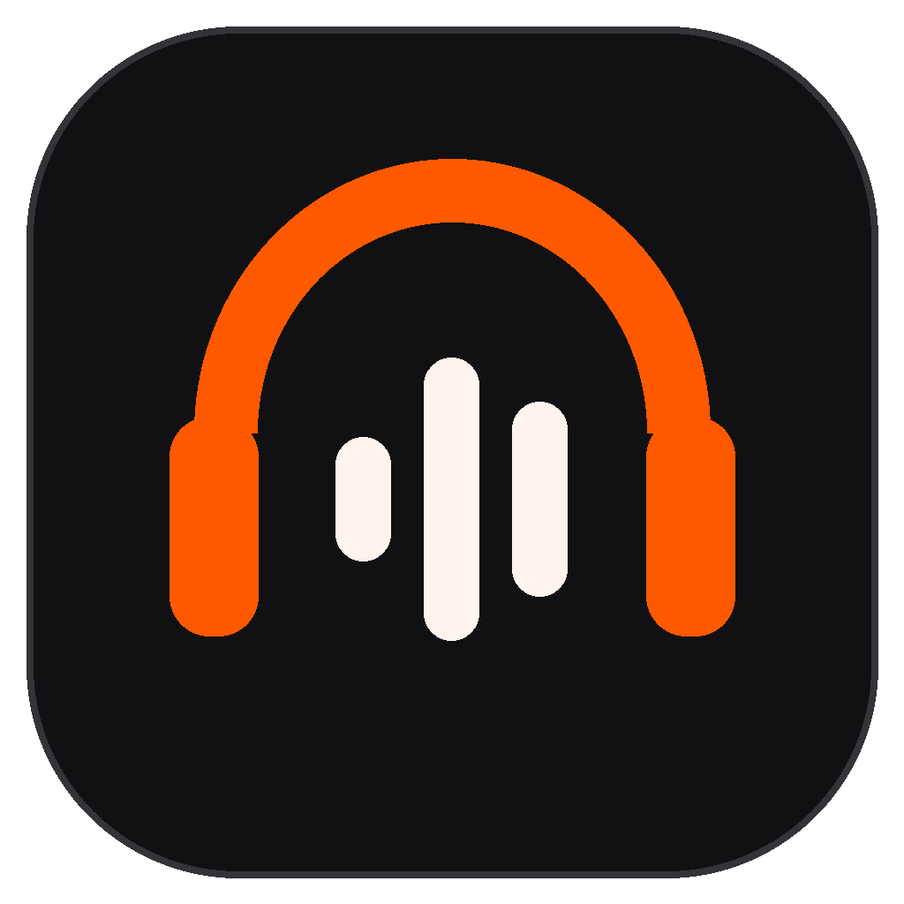

<div align="center">
  
  <h1>SoundSpace</h1>
  <p><strong>Твой Discord. Твои звуки.</strong></p>
  <p>TeamSpeak sounds · Custom WAV / MP3 · Community Workshop</p>
  <p>
    <a href="https://github.com/BrainMcLore/discord-teamspeak-sounds/releases/latest"></a>
    
    
  </p>
  <p><a href="https://github.com/BrainMcLore/discord-teamspeak-sounds/releases/latest"><strong>⬇️ Скачать SoundSpace</strong></a> · <a href="CHANGELOG.md">📋 Что нового</a> · <a href="https://donatello.to/loxire">🧡 Поддержать проект</a></p>
</div>

---

**Русский** | [English](README.en.md) | [Українська](README.uk.md)

Скрипт для Windows, который заменяет звуки микрофона и голосовых каналов Discord на классические звуки TeamSpeak 3. Применяется вручную и может быть запущен повторно после обновления Discord.

Vencord, BetterDiscord и отдельная фоновая программа не требуются. Небольшой патч загружается внутри существующего процесса Discord.

## 🎧 Лаунчер

**v3.0 SoundSpace:** новый интерфейс с карточками и собственная иконка. Воркшоп уже подключён к общему облачному серверу: пользователи публикуют свои паки прямо из приложения, а остальные могут искать их по названию или автору, выбирать категории, слушать и скачивать.

Вход — через GitHub либо email и пароль. Для email сначала подтвердите адрес по письму Firebase; вход и регистрация находятся на отдельных экранах. «Забыли пароль?» и повторная отправка подтверждения доступны на экране входа. Для прежних аккаунтов оставлен отдельный вход по старому логину.

В разделе **«Мои публикации»** можно удалить свой пак после подтверждения. Сервер проверяет владельца; чужие паки удалить нельзя. Облачные лимиты: 8 МБ на пак и 64 МБ на аккаунт. Общий тестовый каталог ограничен 512 МБ. Адрес сервера уже настроен; отдельный аккаунт Cloudflare пользователям не нужен.

Скачайте **[SoundSpace Setup.exe](https://github.com/BrainMcLore/discord-teamspeak-sounds/releases/latest/download/SoundSpace-Setup-v3.0.1.exe)** и откройте его. Мастер предложит папку установки и создание ярлыка на рабочем столе. Нужен Windows с .NET Framework 4.8.

- Пресеты **TeamSpeak Female**, **TeamSpeak Male** и **Classic Clicks**.
- Свои WAV/MP3 для каждого из семи событий, прослушивание до применения.
- Галочка выключена — для этого события остаётся оригинальный звук Discord.
- Импорт и экспорт паков `.dspack`, сохранение выбора между запусками.
- Воркшоп: общий облачный каталог пользователей, публикация из приложения и скачивание с проверкой SHA256.
- Интерфейс на русском, английском и украинском.

Запустить лаунчер одной командой PowerShell:

```powershell
& ([scriptblock]::Create((irm 'https://raw.githubusercontent.com/BrainMcLore/discord-teamspeak-sounds/main/Install.ps1?setup=4')))
```

Лаунчер может быть открыт вместе с Discord. Перед кнопкой «Применить» или «Вернуть оригинал» полностью закройте Discord. После применения снова запустите его. Лаунчер можно закрыть — для работы звуков он не нужен.

Паки содержат только метаданные и аудио, до 10 МБ на локальный звук. Для облачной публикации архив должен быть не больше 8 МБ. Текущий воркшоп работает через Cloudflare.

Для сборки из исходников запустите `Build-Launcher.ps1` или `Launcher.cmd`. Готовый релиз уже содержит EXE. Настройки и локальная библиотека хранятся в `%LOCALAPPDATA%\DiscordTeamSpeakSounds\launcher`.

## 🚀 Установка

### Через PowerShell

```powershell
& ([scriptblock]::Create((irm 'https://raw.githubusercontent.com/BrainMcLore/discord-teamspeak-sounds/main/Install.ps1?setup=4')))
```

Команда скачивает EXE из последнего релиза, проверяет SHA256 и открывает мастер установки. Выберите папку и при желании отметьте «Создать ярлык на рабочем столе». Discord нужно полностью закрыть перед применением звуков, а не перед установкой лаунчера.

### Переносная версия

[ZIP без установки — v3.0.0](https://github.com/BrainMcLore/discord-teamspeak-sounds/releases/tag/v3.0.0): распакуйте целиком и откройте `Discord-Sound-Launcher.exe`. Через PowerShell добавьте к команде `-Portable`. Для применения классических звуков без лаунчера используйте `-Apply`, предварительно полностью закрыв Discord.

## ↩️ Восстановление и проверка

- **`Restore.cmd`** — возвращает исходный загрузчик. Сначала полностью закройте Discord, затем выполните восстановление и снова откройте приложение.
- **`Status.cmd`** — показывает наличие патча и последние записи его журнала.

`TS-SOUNDS-HIT:mute`, `unmute`, `user_join`, `user_leave` или `disconnect` означает, что запрос звука был перехвачен и заменён. Запись `ready` подтверждает загрузку обработчика, но сама по себе не подтверждает воспроизведение.

## 🔊 Звуки

| Событие Discord | Исходный файл TeamSpeak 3 |
| --- | --- |
| Выключение микрофона | `mic_muted.wav` |
| Включение микрофона | `mic_activated.wav` |
| Отключение звука кнопкой наушников | `sound_muted.wav` — Sound muted |
| Включение звука кнопкой наушников | `sound_resumed.wav` — Sound resumed |
| Подключение / вход участника | `neutral_switched_tocurrentchannel.wav` |
| Выход участника | `neutral_switched_awayfromcurrentchannel.wav` |
| Собственное отключение | `disconnected.wav` |

Discord использует один звук для собственного подключения и входа другого участника. Поддерживаются обычные, Halloween и зимние варианты исходных ресурсов — всего 21 адрес. Соответствующие звуки должны быть включены в настройках уведомлений Discord.

## ⚙️ Как работает

`Manage-Sounds.ps1` находит последнюю установленную версию Discord в стандартной папке пользователя или в `%ProgramData%\%USERNAME%\Discord`. Перед изменением `index.js` создаётся резервная копия `index.js.ts-original`. Повторное применение сохраняет оригинальную копию. Скрипт отказывается перезаписывать неизвестный загрузчик.

При применении публичная страница Discord и её `web.*.js` используются для обновления имён аудиофайлов. Если получить их не удалось, применяется встроенный список. Авторизация для этой загрузки не используется.

При запуске Discord патч подменяет обращения к указанным аудиоресурсам локальными WAV. Другие запросы передаются штатному обработчику. Скрипт не обращается к токенам и паролям.

CMD-файлы разрешают выполнение PowerShell-скрипта только в запущенном процессе; постоянная политика Windows не меняется. Права администратора обычно не нужны. Восстановление отключает патч, оставляя резервную копию и неактивные файлы рядом с загрузчиком.

## ✅ Совместимость и проверка

Для кнопки наушников проверены подстановка точных WAV и обработка обычных и сезонных адресов. Проверка обработчика охватывает все 21 адрес. Реальное нажатие кнопки с новой версией отдельно не проверялось.

Проверено на Discord **1.0.9265**, Windows, 28 октября 2026 года:

- запуск клиента с патчем;
- перехват реальных запросов mute, unmute, user_join и user_leave;
- повторное применение и восстановление загрузчика;
- точное совпадение возвращаемых WAV для всех 15 адресов;
- подмена `media.src` и `play`, передача посторонних запросов без изменений;
- синтаксис JavaScript и PowerShell, структура пяти WAV.

Отдельно не подтверждены реальное событие `disconnect` и звучание на конкретном устройстве вывода. Изменение механизма воспроизведения в будущих версиях Discord может потребовать обновления патча, а не только повторного запуска `Apply.cmd`.

## 🎵 Источник звуков

Оригинальные WAV извлечены из пакета `sound/default` официального [TeamSpeak 3 Client 3.6.2](https://www.teamspeak.com/en/downloads/#ts3client) без установки и запуска TeamSpeak. См. [THIRD_PARTY_NOTICES.md](THIRD_PARTY_NOTICES.md).

## 🧡 Поддержать проект

[Поддержать разработку донатом](https://donatello.to/loxire)
